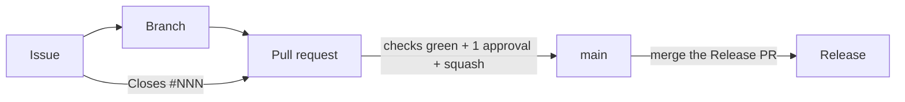

# Contributing

Nothing reaches `main` except through a pull request, and pull requests
should close the issue they resolve. Read the [README](README.md) for the stack itself, and follow
the [Code of Conduct](CODE_OF_CONDUCT.md).

## Setup

1. `nix develop` (or `direnv allow`): creates `.env`, fills `change-me-*`
   secrets, enables the git hooks.
2. `just up -d`, then open <http://localhost:8000>.

Without Nix: `cp .env.example .env`, install `just` and Podman or Docker, and
run `git config core.hooksPath .githooks`.

## The chain



### 1. Issues

- Open issues through one of the four forms (Feature, Bug, R&D, Debt); blank
  issues are disabled. Each form adds its type label and `needs-triage`.
- **Never** report a vulnerability in a public issue; use the private
  security advisory linked from the *New issue* page.
- `openssf` and `auto-update` labels are set by workflows, not by hand. When
  you add a label, describe it and list it here.

### 2. Branches and commits

- Branch from `main` (`feat/add-grid`, `42-fix-proxy-crash`). No direct pushes
  to `main`; rebase rather than merging `main` in.
- Commits and PR titles are [Conventional Commits](https://www.conventionalcommits.org/en/v1.0.0/#summary):
  `<type>[(scope)][!]: description`, lower-case description, no trailing
  period. Types: `feat fix docs style refactor perf test build ci chore revert`.
  [Cheatsheet](https://gist.github.com/qoomon/5dfcdf8eec66a051ecd85625518cfd13#commit-message-formats).
- The type sets the next version: `fix` → patch, `feat` → minor, `!` or a
  `BREAKING CHANGE:` footer → major; other types don't release.
- Commits must be **signed off** (`git commit -s`) and **signed**. One-time
  SSH signing setup, then add the key on GitHub as a *Signing Key*
  ([docs](https://docs.github.com/en/authentication/managing-commit-signature-verification/about-commit-signature-verification)):

  ```bash
  git config --global gpg.format ssh
  git config --global user.signingkey ~/.ssh/id_ed25519.pub
  git config --global commit.gpgsign true
  ```

The `commit-msg` hook checks all of this locally (opt out of the signing part
with `git config hooks.requireSignature false`). It is only feedback —
`--no-verify` skips it; CI and the ruleset are the real gate. The type list
lives in both `.githooks/check-conventional-commit-msg` and
`check-conventional-commit-pr-title.yml`; keep them identical.

### 3. Pull requests

- Fill in the template and link the issue with `Closes #NNN`. The PR title
  becomes the squash commit on `main`.
- 1 approval (plus code owners where set) and every thread resolved.
- The ruleset requires a single check, `ci-required`, on a branch up to date
  with `main`. It aggregates the `ci.yml` jobs below; `conventional-title`
  runs too but is advisory.

| Check | Enforces | Reproduce locally |
| ----- | -------- | ----------------- |
| `conventional-title` (advisory) | PR title (and a lone commit) is a Conventional Commit | — edit the title, it re-runs |
| `ci-required` ← `devshell` | the flake evaluates | `nix flake check --no-build` |
| `ci-required` ← `node` | each Node.js service lints, tests and builds | `npm run lint && npm test` in its folder |
| `ci-required` ← `dockerfile-lint` | hadolint on every Dockerfile | `hadolint <file>` |
| `ci-required` ← `compose-lint` | compose file resolves | `podman-compose config` |
| `ci-required` ← `workflow-lint`, `zizmor` | workflows lint clean and pass the security audit | `just lint-workflows` |
| `ci-required` ← `dependencies-audit` | no Critical/High and fewer than 5 Moderate+Low advisories | bump the dependency |
| `ci-required` ← `stack` | the stack boots and every route answers | `just up -d && just logs` |
| `ci-sast-required` (opt-in) | no CodeQL error; SonarQube gate passes | see [`.sast/README.md`](.sast/README.md) |

Before opening: issue linked, PR title a Conventional Commit, branch rebased, `just lint-workflows` run if you
touched `.github/`, tests and docs updated, AI-assisted changes reviewed line
by line.

### 4. Releases

Never by hand. release-please keeps a Release PR open with the next version
and changelog; merging it tags the release (no `v` prefix), and
`release-to-ghcr.yml` publishes signed images.

## Tools in the dev shell

`just`, `podman`/`podman-compose`, `actionlint` + `shellcheck`, `zizmor`
(same version as CI), `check-jsonschema`, `pin-github-action` (pins `uses:` to
commit SHAs) and `jq`.

## Troubleshooting

**Stack not working?** Run `just compose-diagnostic` first. It checks the
container tool, `.env`, the compose file, each container's state, health and
logs, the host ports, Traefik's routes and the disk, then lists what looks
wrong in plain words. The full report (logs and state) is saved as
`.compose-diagnostic-<time>.md` (git-ignored) with `.env` values and other credentials masked: skim it, then
attach it to your bug issue or send it to the DevOps team.

Record every incident under [`docs/troubleshooting/`](docs/troubleshooting/),
in a subfolder per area, one Markdown file per incident:

```
docs/troubleshooting/
├── podman/not-a-directory-on-wsl.md
├── ci/stack-job-timeout.md
└── backend/prisma-openssl-missing.md
```

Each file names the **Error** (what was observed), its **Occurrences**
(dates, environment), the **Cause** and the **Solution**, written for someone
who wasn't there. Same cause as an existing entry? Add an occurrence to it
instead of a new file; link related entries by relative path. Example:

```markdown
# Podman "Not a directory" when starting the stack

**Error:** `just up` fails with `mount ... not a directory` on every container.

**Occurrences:** 2026-01-01 (WSL2, repo under /mnt/c).

**Cause:** the repo sits on a network/virtualised filesystem; overlay storage
needs POSIX semantics.

**Solution:** set `PODMAN_STORAGE_DIR` to a path on a local disk, or move the
repo into the Linux filesystem.
```
