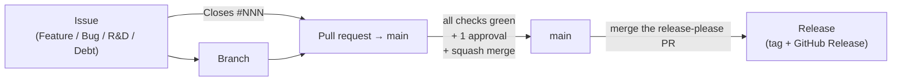

# Contributing

Nothing reaches `main` except through a pull request, and every pull request
traces back to an issue. This document explains that chain, the conventions,
and the CI gates that enforce them. Read the [README](README.md) first for the
stack itself, and follow the [Code of Conduct](CODE_OF_CONDUCT.md).

## Setup

1. `nix develop` (or `direnv allow`). The shell creates `.env` from
   `.env.example`, fills any `change-me-*` secret, and points git at the
   in-repo hooks.
2. `just up -d`, then open <http://localhost:8000>.
3. Without Nix: `cp .env.example .env`, install `just` and Podman or Docker,
   and enable the hooks yourself with `git config core.hooksPath .githooks`.

## The governance chain



You can always work *ahead* (push a branch, draft an issue), but you cannot
*merge* ahead: each link must exist before the next one completes.

| To do this...           | You first need...                                        |
| ----------------------- | -------------------------------------------------------- |
| Open a pull request     | An existing issue the PR closes (`Closes #NNN`)          |
| Merge to `main`         | A green PR with 1 approval and every required check      |
| Cut a release           | Merge the `release-please` Release PR                    |

## 1. Issues and labels

- Blank issues are disabled; use one of the four forms (below).
- Security vulnerabilities are **never** public issues — use a private
  security advisory (linked from the *New issue* page).

| Label | Set by | Meaning |
| ----- | ------ | ------- |
| `feature`, `bug`, `research`, `debt` | issue forms | issue type |
| `needs-triage` | issue forms | removed by a maintainer once understood and sized |
| `openssf`, `auto-update` | `openssf-scorecard.yml` | opened/refreshed by a workflow — don't set by hand |

When adding a label, give it a description and document it here in the same PR.

## 2. Branching and commits

- Branch from `main`, prefixed by type or issue number: `feat/add-grid`,
  `42-fix-proxy-crash`.
- **No direct pushes to `main`**, **linear history** (rebase, don't merge
  `main` in), **squash merge** only.
- Commits and PR titles are Conventional Commits (rules below). The type
  drives the next release version:

| Commit type | Version effect |
| ----------- | -------------- |
| `fix:` | patch — `x.y.+1` |
| `feat:` | minor — `x.+1.0` |
| `feat!:` / `BREAKING CHANGE:` footer | major — `+1.0.0` |
| `docs`, `ci`, `chore`, `refactor`, `test`, … | no release |

### Commit hooks

`nix develop` points `core.hooksPath` at `.githooks/`. `commit-msg` checks the
Conventional Commits format and, when the repo opts in, signing:

```bash
git config hooks.requireSignature true   # opt in (per clone)
git config --global gpg.format ssh
git config --global user.signingkey ~/.ssh/id_ed25519.pub
git config --global commit.gpgsign true
git commit -s ...                         # adds the Signed-off-by trailer
```

Add the same key on GitHub as a **Signing Key**. `--no-verify` skips the hooks;
the enforced gates are in CI and the branch ruleset.

## 3. Pull requests

- Fill in the template; `Closes #NNN` is **required**.
- The PR title becomes the squash commit on `main`, so it must be a
  Conventional Commit.
- Resolve every review thread; 1 approval (plus CODEOWNERS where set) is
  required.

### The PR gate

The ruleset requires `ci-required`, `conventional-title` and `linked-issue`,
with the branch up to date with `main`.

| Check | Enforces | Fix it with |
| ----- | -------- | ----------- |
| `conventional-title` | PR title (and a single commit's message) is a Conventional Commit | edit the title — the check re-runs |
| `linked-issue` | the PR closes at least one issue | add `Closes #NNN` to the body |
| `ci-required` ← `devshell` | `flake.nix` evaluates, the shell has its tools | `nix flake check --no-build` |
| `ci-required` ← `dockerfile-lint` | hadolint passes on every Dockerfile | `hadolint <file>` |
| `ci-required` ← `compose-lint` | `docker-compose.yml` resolves with `.env.example` | `podman-compose config` |
| `ci-required` ← `workflow-lint` | actionlint + shellcheck on every workflow | `just lint-workflows` |
| `ci-required` ← `zizmor` | no workflow security finding | `just lint-workflows` |
| `ci-required` ← `dependencies-audit` | no Critical/High, fewer than 5 Moderate+Low advisories in lockfiles | bump the dependency |
| `ci-required` ← `stack` | the compose stack boots and every service answers | `just up -d && just logs` |
| `ci-sast-required` (opt-in) | CodeQL has no error-level alert; SonarQube gate passes when configured | see `.sast/README.md` |

### Checklist before opening a PR

- [ ] An issue exists, and the PR body says `Closes #NNN`
- [ ] The branch is rebased on `main`
- [ ] Commits and the PR title are Conventional Commits
- [ ] `just lint-workflows` passes if you touched `.github/`
- [ ] Tests and docs updated if behaviour changed
- [ ] AI-assisted changes reviewed line by line by a human

## 4. Local testing tools

`nix develop` provides these, so CI checks can run before pushing:

| Tool | Use it to |
| ---- | --------- |
| `just` | run the project recipes (`just` lists them) |
| `podman` / `podman-compose` | run the full stack locally (`just up -d`) |
| `actionlint` | lint workflows: syntax, expressions, and `run:` scripts via shellcheck |
| `zizmor` | audit workflows for security issues, same version as CI |
| `check-jsonschema` | validate workflows against GitHub's schema |
| `shellcheck` | lint shell scripts (`.githooks/`, `scripts/`) |
| `pin-github-action` | pin `uses:` refs to commit SHAs (`pin-github-action .github/workflows/x.yml`) |
| `jq` | inspect JSON output |

`just lint-workflows` runs the first three the way CI does.

## 5. Troubleshooting

Record every incident and its fix in [`docs/Troubleshoot.md`](docs/Troubleshoot.md).

- Each entry names the **Error** (what was observed), its **Occurrences**,
  the **Cause** and the **Solution**.
- Write it so someone who wasn't there can recognise the symptom and fix it.
- **No duplicates:** if the cause or solution matches an existing entry, add
  the new occurrence to that entry instead of creating another one.
- Entries may link earlier ones ("same cause as [X](#x)").

## 6. Releasing

Releases are never cut by hand. `release-please` keeps one **Release PR**
open against `main`, with the next version (from Conventional Commit history)
and the CHANGELOG. Merging it tags the release (no `v` prefix), publishes the
GitHub Release, and `release-to-ghcr.yml` pushes signed images to GHCR.
Don't bump versions by hand.

## 7. Related automation

| Workflow | Trigger | Purpose |
| -------- | ------- | ------- |
| `ci.yml` | PR, push to `main` | lint, stack boot, `ci-required` gate |
| `ci-sast.yml` | PR, push to `main` | CodeQL / SonarQube; reports committed to `.sast/report/` |
| `check-conventional-commit-pr-title.yml` | PR | `conventional-title` |
| `check-pr-linked-issue.yml` | PR | `linked-issue` |
| `release-please.yml` | push to `main` | maintain the Release PR, tag releases |
| `release-to-ghcr.yml` | release created | build, SBOM, sign and push images |
| `openssf-scorecard.yml` | weekly (Mon 09:00 UTC) | supply-chain audit; issue + one-click PR |
| `make-pr-draft.yml` | PR opened (opt-in) | convert new PRs to draft |

## Reference

### Conventional Commits

Commits and PR titles follow [Conventional Commits](https://www.conventionalcommits.org/):
`<type>[(scope)][!]: description`, with the description starting lower-case and
carrying no trailing period. Both ends enforce the **same rule set** — the same
type list, the same optional scope and `!`, the same subject pattern.

- **Local (advisory):** the `.githooks/commit-msg` hook — auto-enabled by the
  flake `shellHook` on `nix develop`, which points `core.hooksPath` at
  `.githooks/` — execs `.githooks/check-conventional-commit-msg`, which rejects
  a malformed message as you write it. Bypassable with `git commit
  --no-verify`, so it is only a convenience.
- **CI (enforced):** `.github/workflows/check-conventional-commit-pr-title.yml`
  validates the **PR title** via [`amannn/action-semantic-pull-request`](https://github.com/amannn/action-semantic-pull-request).
  On a squash merge the PR title is the commit that lands on `main`, so this is
  the real gate. A bad title is fixed by editing it in the GitHub UI (the check
  re-runs on `edited`) — no history rewrite.

Keep the two in sync when you customise: the type list lives in both
`.githooks/check-conventional-commit-msg` and
`.github/workflows/check-conventional-commit-pr-title.yml`.

Make your developers refer to the [Conventional Commits Cheatsheet](https://gist.github.com/qoomon/5dfcdf8eec66a051ecd85625518cfd13#commit-message-formats)   
or the [Official Summary](https://www.conventionalcommits.org/en/v1.0.0/#summary) for convenience. 

### Issue templates

`.github/ISSUE_TEMPLATE/` ships four [issue forms](https://docs.github.com/en/communities/using-templates-to-encourage-useful-issues-and-pull-requests/configuring-issue-templates-for-your-repository)
— structured fields rather than a blank box — and `config.yml` turns off blank
issues, so every issue arrives in one of these shapes. Each form auto-applies a
type label plus `needs-triage`, and each opens with a "not a duplicate"
pre-submit check.

| Form | For | Key fields |
| ---- | --- | ---------- |
| **Feature** | a new capability or an enhancement | Problem (the need, not the solution), Proposed solution, Alternatives, rough scope |
| **Bug** | incorrect behaviour in something that exists | What's wrong, Steps to reproduce (from a clean checkout), Expected vs actual, Environment (`git rev-parse HEAD`), Logs |
| **R&D** | a research spike or open design question | Question/hypothesis, Definition of done, Context and constraints, rough scope |
| **Debt** | it works, but the code or design carries a shortcut | The shortcut (and where), Cost it carries, Proposed cleanup, interest accrual |

Security reports are routed away from public issues: `config.yml` links to
**private vulnerability reporting** instead (replace `OWNER/REPO` after using the
template).

The forms are the front half of the workflow: an issue defines the *problem*, a
PR closing it carries the *solution*. That split is why the PR template can
stay so small.

### Pull request template

`.github/PULL_REQUEST_TEMPLATE.md` pre-fills every new PR. It is deliberately
short: the [issue forms](.github/ISSUE_TEMPLATE/) already capture the *problem*
(what's wrong, repro, proposed change, alternatives), and the Conventional-Commit
PR title already encodes the *type* of change. Repeating any of that in the PR
body is noise. Every PR is expected to close an issue, so the template only asks
for what a **reviewer** can't get from the linked issue or the diff:

| Field | Why it's there |
| ----- | -------------- |
| `Closes #NNN` | Required. Links the issue and auto-closes it on merge. Branch and push first if you like, but the issue must exist before the PR is opened. |
| What changed | One or two lines on the shape of the diff — the "why" stays in the issue. |
| How it was verified | The steps a reviewer repeats to trust the change; not something the issue knows. |
| Risk / rollback | Breaking changes, migrations, blast radius. "None" is a valid answer. |
| Checklist | "meant to close an issue" plus tests / docs — the easily-forgotten parts. |
